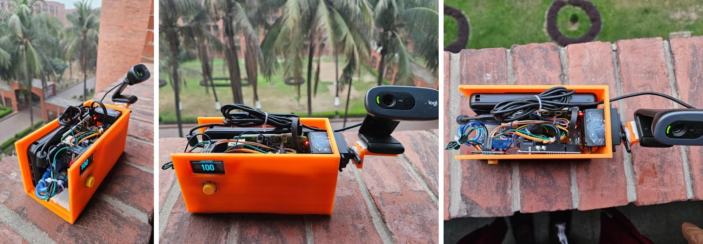
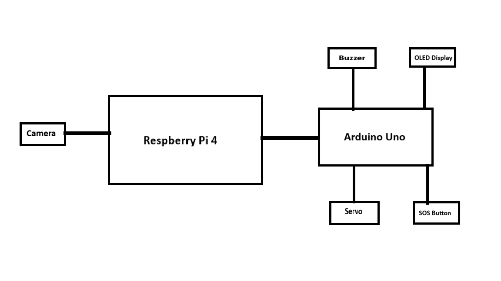
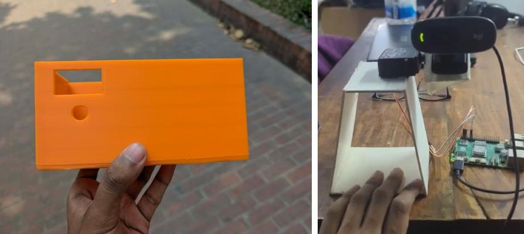
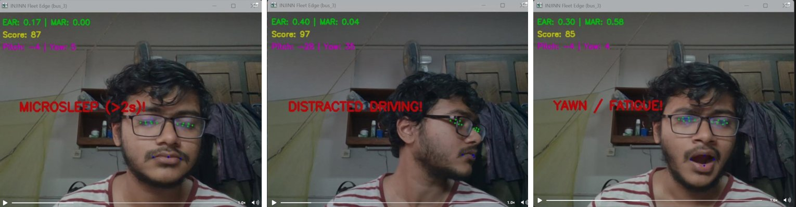
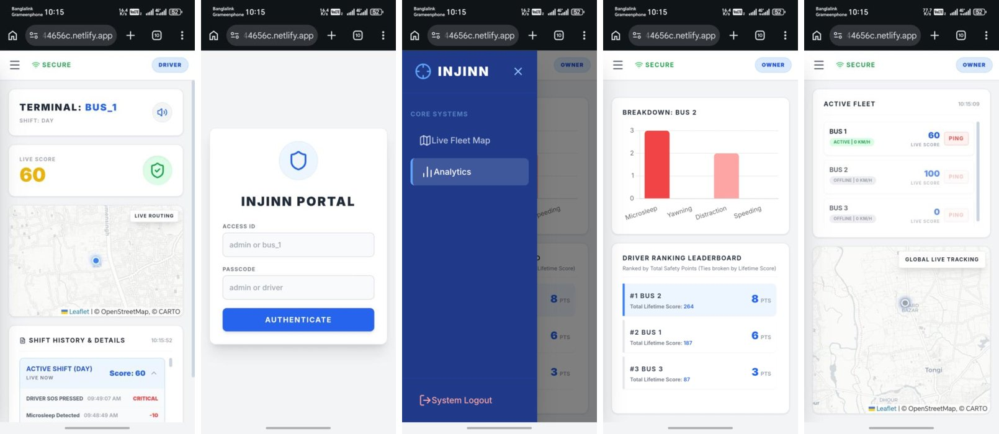
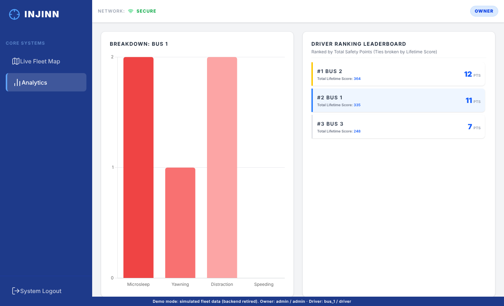
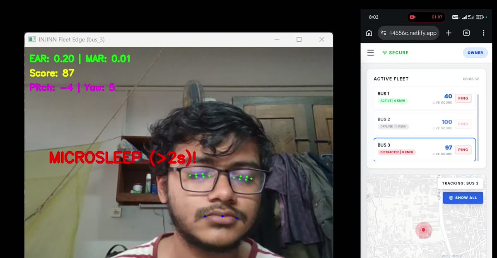
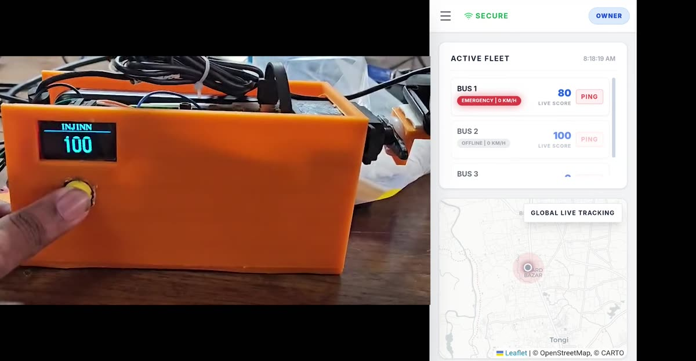

# INJINN: IoT-based Driving Safety Suite with Oculomotor

A dashboard-mounted unit that watches the driver through a webcam and flags microsleep, yawning and distraction. It sounds a buzzer, shows a safety score on an OLED, and tilts the camera to keep the driver's face in frame. Each unit pushes its state, score and incident log to Firebase, and a web portal shows the whole fleet to an owner and each vehicle's own data to its driver.

Course project for **EEE 4518: Electrical and Electronic Workshop**, Department of EEE, Islamic University of Technology (IUT), submitted 13 April 2026.

**Stack:** Python, MediaPipe Face Landmarker, OpenCV, Raspberry Pi 4, Arduino Uno (C++), pySerial, Firebase Realtime Database (REST), HTML/JavaScript with Tailwind CSS, Leaflet and Chart.js, Netlify.



**Demo video:** https://youtu.be/JEI0bmbcsGw  ·  **Portal demo:** https://yasinsaad.github.io/EEE4518-Team_Injinn/

> **Status:** the project ended with the course and its Firebase backend has been shut down. The portal demo runs on simulated fleet data in the browser. This repository documents the system; to run the full system, set up your own Firebase project (see [Quick start](#quick-start)).

## Contents

- [Team](#team)
- [System overview](#system-overview)
- [Repository layout](#repository-layout)
- [Quick start](#quick-start)
- [Hardware](#hardware)
- [Detection and scoring](#detection-and-scoring)
- [Camera tilt control](#camera-tilt-control)
- [Raspberry Pi ↔ Arduino serial protocol](#raspberry-pi--arduino-serial-protocol)
- [Cloud data model](#cloud-data-model)
- [Fleet portal](#fleet-portal)
- [Demonstration video](#demonstration-video)
- [Known limitations](#known-limitations)
- [Project history](#project-history)

## Team

| Member | ID | Contribution |
|---|---|---|
| Md. Jubair Ali Fahim | 220021203 | Initial Python codebase, alert system, SOS feature |
| Arham Takib | 220021208 | Web portal, Firebase backend, testing |
| Mubtasim Labib | 220021242 | Hardware prototype, 3D-printed enclosure, camera tilt control |
| Tashfeea Ainur Rahman | 220021250 | OLED interface, tilt tuning, Pi–Arduino serial protocol |
| Yasin Hasan Saad | 220021252 | MediaPipe vision pipeline, migration to Raspberry Pi, system integration |

## System overview



| Layer | Runs on | Code | Role |
|---|---|---|---|
| Vision and telemetry | Raspberry Pi 4 | `raspberry-pi/main.py` | Face landmark tracking, driver-state detection, scoring, camera tilt commands, Firebase sync |
| Peripheral control | Arduino Uno | `arduino/injinn_firmware/` | Servo, buzzer, OLED score display, SOS button |
| Fleet portal | Browser | `portal/index.html` | Owner and driver dashboards reading from Firebase |

Data flow:

1. The webcam feeds frames to `main.py`. MediaPipe Face Landmarker returns 478 landmarks and a head-pose matrix per frame.
2. `main.py` computes eye and mouth aspect ratios and head pitch and yaw. It updates the score and sends alert codes and servo angles to the Arduino over USB serial.
3. Every 0.5 s, `main.py` writes the vehicle's status to Firebase and sends the score to the Arduino for display.
4. The portal polls Firebase every second. An owner can send a "ping" to a vehicle, which `main.py` picks up and relays to the buzzer.
5. Pressing the SOS button makes the Arduino send `SOS_TRIGGERED`. `main.py` then sets the vehicle state to `EMERGENCY` and logs the event.

## Repository layout

```
raspberry-pi/
  main.py                 Edge unit: vision, scoring, servo control, serial and Firebase I/O
  requirements.txt
arduino/injinn_firmware/
  injinn_firmware.ino     Servo, buzzer, OLED and SOS button firmware
portal/
  index.html              Single-file fleet portal
  demo-data.js            Simulated fleet that stands in for the retired Firebase backend
.github/workflows/
  pages.yml               Publishes portal/ to GitHub Pages
prototypes/               Earlier development versions (see "Code history")
docs/images/              Figures used in this README
```

## Quick start

### Edge unit (Raspberry Pi, or any PC with a webcam)

```bash
cd raspberry-pi
pip install -r requirements.txt
python main.py --preview
```

- On first run, enter a vehicle ID such as `bus_1`. It is saved to `bus_id.txt`.
- The MediaPipe model (`face_landmarker.task`) downloads automatically on first run.
- `--preview` opens the annotated camera window; press `q` to quit. Omit it on the Pi to run headless, and stop with Ctrl+C.
- `--port` sets the Arduino serial port (default `/dev/ttyACM0`; on Windows, for example, `--port COM5`). If no Arduino is found, the unit runs without the servo, buzzer, OLED and SOS button.
- The script opens camera index 1 and falls back to index 0.
- On exit, it writes `state: offline` to Firebase.

### Arduino

1. Install the **U8g2** library from the Arduino Library Manager. `Servo` and `Wire` come with the IDE.
2. Open `arduino/injinn_firmware/injinn_firmware.ino`, select Arduino Uno, and upload.
3. The OLED shows the INJINN start-up animation, then the score.

### Portal

Open `portal/index.html` in a browser, or deploy the `portal/` folder to any static host. Log in with the credentials in [Fleet portal](#fleet-portal). By default the portal runs in demo mode; to connect it to a live database, remove the `demo-data.js` script tag from `index.html`.

### Using your own Firebase project

Set `FIREBASE_DB_URL` in `raspberry-pi/main.py`, and `FIREBASE_URL` and `FIREBASE_BASE` in `portal/index.html`. The code uses the REST API without authentication, so the database rules must allow public reads and writes to `fleet/`.

## Hardware

### Bill of materials

| Item | Purpose | Cost (BDT) |
|---|---|---|
| Raspberry Pi 4 | Runs vision pipeline and telemetry | 14,000 |
| Arduino Uno | Peripheral controller | 1,000 |
| 1.3" OLED, SH1106, I²C | Score display | 350 |
| Servo motor | Camera tilt | 400 |
| USB webcam (Logitech) | Driver camera | 2,300 |
| Buzzer, active-low | Audible alert | 80 |
| Power bank | Power supply | 1,500 |
| Breadboard | Wiring | 150 |
| 3D-printed housing | Enclosure | 900 |
| Push button | SOS input | – |
| **Total** | | **20,680** |

### Arduino pin map

| Pin | Connection |
|---|---|
| D9 | Servo signal |
| D8 | Buzzer (driven LOW to sound) |
| D7 | SOS button to GND (internal pull-up) |
| A4 / A5 (SDA / SCL) | OLED |
| USB | Raspberry Pi, appears as `/dev/ttyACM0`, 9600 baud |

The webcam connects to the Raspberry Pi over USB and is mounted on the servo arm outside the enclosure. The OLED and SOS button sit on the enclosure's side panel.



## Detection and scoring

Each shift starts at a score of 100. The shift is "Day" from 06:00 to 18:00 and "Night" otherwise. At a shift change, the score resets to 100 and a shift summary is logged. If the unit restarts mid-shift, it resumes the score stored in Firebase.

| Event | Condition | Penalty | Arduino code | Portal state |
|---|---|---|---|---|
| Microsleep | EAR < 0.25 for > 2.0 s | −10 | `881` | `drowsy` |
| Yawn / fatigue | MAR > 0.5 for > 2.5 s | −2 | `883` | `drowsy` |
| Distraction | pitch > 15° or \|yaw\| > 25° for > 3.0 s | −3 | `882` | `distracted` |
| Speeding | estimated speed > 60 km/h | −1 per ~2 s | – | `speeding` |
| SOS button | button press, 3 s debounce | none | – | `EMERGENCY` |

After an alert fires, the same detector cannot fire again until the condition has held for another 5 s plus its hold time. All thresholds are constants at the top of `main.py`.

Definitions:

- **EAR (eye aspect ratio)**: the average over both eyes of (sum of two vertical eyelid distances) / (2 × horizontal eye width). The landmarks are 33, 160, 158, 133, 153, 144 for the left eye and 362, 385, 387, 263, 373, 380 for the right.
- **MAR (mouth aspect ratio)**: the inner-lip vertical gap (landmarks 13–14) divided by the mouth width (78–308).
- **Pitch and yaw**: taken from MediaPipe's facial transformation matrix.



## Camera tilt control

The servo tilts the camera vertically. There is no pan. The controller is a step controller with a deadband:

- The tracked point is the nose-bridge landmark (index 1). Its vertical position is normalised to the frame, 0 at the top and 1 at the bottom.
- If the point is above 0.35, the servo steps 2.5° in one direction. If it is below 0.65, the servo steps 2.5° in the other. Between those values the servo holds still.
- The servo moves at most once every 0.1 s, and its angle is limited to 30–110°.
- If no face is visible for more than 1 s, the servo sweeps between the limits in 5° steps until it finds one.

## Raspberry Pi ↔ Arduino serial protocol

The link runs at 9600 baud. Each message is one ASCII line ending in `\n`.

| Pi → Arduino | Meaning |
|---|---|
| `1`–`180` | Set servo angle in degrees |
| `881`, `882`, `883` | Alert: microsleep, distraction, yawn. Gives a 200 ms beep. |
| `999` | Owner ping. Gives a 200 ms beep. |
| `1000 + score` | Update the OLED score (`1087` displays 87) |

| Arduino → Pi | Meaning |
|---|---|
| `SOS_TRIGGERED` | SOS button pressed |

## Cloud data model

The system uses a Firebase Realtime Database, accessed through its REST API:

```
fleet/
  <bus_id>/
    current_status   { state, speed_kmh, location: {lat, lng}, score, session }
    history/         push-ID → { event, penalty, time, date }
    command          { trigger: true | false }
```

- **`state`** takes one of these values: `active`, `drowsy`, `distracted`, `speeding`, `EMERGENCY`, `offline`.
- **`history`**: at each shift change, `main.py` deletes every entry except the "Shift Summary" lines, then appends a summary for the shift that just ended.
- **`command`**: the portal sets `trigger: true` to ping a vehicle. `main.py` polls this every 1.5 s, beeps, and resets it to `false`.

## Fleet portal

Try it: https://yasinsaad.github.io/EEE4518-Team_Injinn/

The hosted portal runs in **demo mode**. `demo-data.js` intercepts the portal's Firebase requests and answers them from a simulated fleet:
- Bus 1 and Bus 2 are driving and log random incidents, using the real incident types and penalties.
- Bus 3 is offline.
- Pressing PING puts the target vehicle into `EMERGENCY` for a few seconds.
- Past shift summaries are pre-filled so the leaderboard has data.

The portal code itself is unchanged.





The portal has two logins. These demo credentials are hardcoded in the page and protect nothing:

| Role | Access ID | Passcode | View |
|---|---|---|---|
| Owner | `admin` | `admin` | All vehicles |
| Driver | `<bus_id>`, e.g. `bus_1` | `driver` | Own vehicle only |

**Owner view:**
- A fleet list showing each vehicle's state, speed and live score, with a PING button.
- A map that can follow one vehicle.
- A per-vehicle incident bar chart.
- A leaderboard.

**Driver view:**
- The vehicle's live score.
- A map.
- Shift history.
- Audible alerts in the browser.

**Leaderboard:** each logged shift summary earns points by final score:

| Final shift score | Points |
|---|---|
| ≥ 80 | 3 |
| 56–79 | 2 |
| 40–55 | 1 |

Vehicles rank by total points, and ties go to the higher sum of shift scores.

The portal marks a vehicle `offline` if its status has not changed for 5 minutes.

## Demonstration video

[YouTube, 87 s](https://youtu.be/JEI0bmbcsGw). It shows three parts:

1. **Detection, 0–42 s.** The PC version (`prototypes/05_pc_demo.py`, now `main.py --preview`) runs on a laptop in a window titled "INJINN Fleet Edge (bus_3)". The window shows the camera feed with the EAR/MAR, score and pitch/yaw overlay. Next to it, a phone shows the owner portal. The driver acts out distraction, microsleep and a yawn. The on-screen score falls 100 → 97 → 87 → 85 → 82 → 72, which matches the penalties above (−3, −10, −2, −3, −10). Bus 3's portal state changes to `distracted` or `drowsy` with each alert.
2. **Camera tilt, 42–72 s.** The person crouches and stands in front of the unit, and the servo tilts the webcam to follow their face. The OLED shows the live score.
3. **SOS, 75–84 s.** Pressing the yellow button changes Bus 1 to `EMERGENCY` on the owner portal, and its map marker pulses.





## Known limitations

This is a classroom prototype, not a deployable product.

- **Location and speed**: these come from IP geolocation (`ip-api.com`) polled every 10 s, not GPS. Speed is the distance between successive IP fixes, so it is unreliable, and the speeding penalty can fire falsely or not at all.
- **Map position**: the portal ignores the reported coordinates and places every vehicle at a fixed point on the IUT campus.
- **Security**: the Firebase database was used without authentication, and the portal's logins are checked in client-side JavaScript. A real deployment would need Firebase Authentication and database rules.
- **Thresholds**: the EAR, MAR and head-pose thresholds were set by hand and tested on team members only. No accuracy or false-alarm measurements were recorded.
- **Tilt only**: the camera mount tilts but does not pan, so the unit loses a driver who moves sideways out of frame.

## Project history

| Weeks | Work |
|---|---|
| 1–7 | Python and OpenCV environment for blink tracking |
| 8 | MediaPipe vision pipeline |
| 9–13 | Attempted deployment on an Nvidia Jetson Nano, abandoned due to faulty hardware |
| 14 | Web portal and Firebase backend |
| 15 | Moved to Raspberry Pi 4 and Arduino. Circuit design and camera tilt mount. |
| 16 | OLED, buzzer, SOS, serial protocol, integration, enclosure |

The project was first proposed as software-only drowsiness detection. The hardware unit, portal and scoring were added during the semester.

### Code history

The files in `prototypes/` record how the vision code developed. None of them talk to the Arduino.

| File | Stage |
|---|---|
| `01_blink_counter.py` | MediaPipe Tasks API test. Counts blinks with EAR < 0.25 for ≥ 2 frames. No alerts or cloud. |
| `02_microsleep_firebase.py` | First Firebase version, hardcoded to `bus_1`. Microsleep (eyes closed > 2 s, −10) plus a "repeated long blinks" rule: two consecutive blinks of 1–2 s cost −5. No yawn or distraction detection. The long-blink rule was dropped in later versions. |
| `03_auto_level_sim.py` | `05_pc_demo.py` plus a simulated camera-levelling loop. It tracks the eye-corner midpoint against a 0.45–0.55 band and adjusts a 0–1 value, but drives no hardware. `main.py` later replaced this with the servo controller. |
| `04_session_counter.py` | Alternative shift handling. Each run is numbered "Day N" or "Night N" (stored in `session_counts.json`), and the shift summary is written when the program exits, not at 06:00/18:00. |
| `05_pc_demo.py` | PC version with a preview window and no Arduino. Used for the detection part of the demo video. |

### Changes after submission

The code was cleaned up after the course ended. Detection logic, thresholds, penalties and the serial protocol are unchanged.

- `main.py`:
  - Restructured with named constants, docstrings and helper functions.
  - Added `--preview` and `--port` options, so one script now covers both the Pi and the PC.
  - Runs without an Arduino.
  - Resumes the cloud score after a mid-shift restart.
  - Opens the serial port before the background threads start.
- Firmware:
  - Non-blocking beep, so serial reads and button polling continue while the buzzer sounds.
  - Debounced SOS button.
  - Unused alert-text code removed.
- Portal:
  - Header comment added.
  - Leftover analytics tag from an earlier host removed.
  - Demo mode (`demo-data.js`) added, and the portal is hosted on GitHub Pages.
- Files moved into `raspberry-pi/`, `arduino/` and `portal/`.

The original code is in the repository's first commit.
